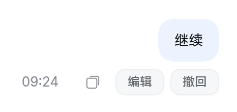
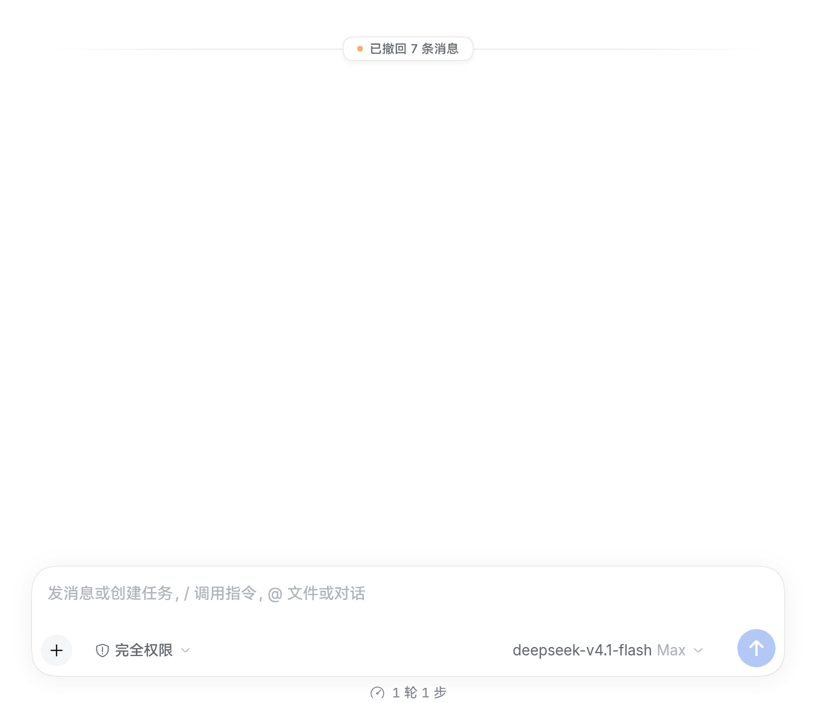

<div align="center">

# 🧭 dsh-retrace · Session Time Machine

**Seamless Message Recall, In-Place Edit & Resend, Regeneration, and Workspace Artifact Versioning for DeepSeek Harness**

[](https://github.com/daha1216/dsh-retrace/commits/main)
[](https://github.com/daha1216/dsh-retrace/blob/main/LICENSE)
[](https://github.com/topics/dsh-plugin)
[](https://github.com/daha1216/dsh-retrace/pulls)

[中文详细说明](./README.zh.md) · **English**

</div>

---

Ever found yourself in these frustrating scenarios while using DeepSeek Harness?
- **Accidentally pressed Enter too early** or missed a critical instruction, having to watch the agent drift completely off-topic and forcing you to discard the session and start from scratch?
- The agent executed an extensive sequence of tool calls and corrupted files in your project, leaving you wanting to **not just revert the chat history, but restore the affected files as well**?
- Hesitant to explore alternative approaches within a single conversation because there's no easy way to roll back?

**dsh-retrace** turns your DeepSeek Harness sessions into a safe, fully reversible playground. Seamlessly integrated into DSH Web and Desktop, it offers **whole-turn recall, in-place edit-and-resend, instant regeneration**, paired with **synchronized workspace file snapshots and Git integration**.

---

## 📸 Real-World Experience

<div align="center">

| Native Action Bar Integration | Clean Post-Recall State |
| :---: | :---: |
|  |  |
| *Native "Edit" and "Recall" action pills embedded right beside message timestamps* | *Erase entire turns (Prompt, replies, and tool executions) in one click; clean canvas with instant prompt echo* |

</div>

---

## ✨ Features

### 1. ↩ Effortless Whole-Turn Recall
- **Erase an entire turn cleanly**: Removes the user prompt, the assistant reply, and all intermediate tool call rows from both the chat view and the model context.
- **Smart composer echo**: Recalling a message immediately copies its text back into the composer, so you can tweak and resend without retyping.
- **Two-step accidental-click protection**: Recall actions feature a quick confirmation step to prevent accidental triggers.

### 2. ✎ In-Place Edit & Resend
- **Instant prompt correction**: Click "Edit" under any user message to refine your prompt directly in line.
- **Collapsible original prompt reference**: Resent messages can retain a neat, collapsible view of the previous prompt for comparison (display-only, does not inflate model context).
- **Flexible conversation modes**: By default, replaces only the targeted turn. Optionally choose "Start from a new conversation after edit" in settings to cleanly fork your session forward.

### 3. ↻ Instant Regeneration
- Hover over any assistant response and hit "Regenerate" to clear the output and let the agent answer again with fresh perspective.

### 4. ↩️ Synchronized Conversation & Artifact Rollback
- **Beyond chat-only undo**: Reverting conversation without reverting file changes leaves your workspace out of sync. dsh-retrace captures snapshots of touched files along with conversation states.
- **Three-way rollback options**: Choose **"Conversation only"**, **"Artifacts only"**, or **"Both together"** with dry-run previews.
- **Git-first with content-addressed fallback**: Seamlessly leverages your Git workspace when available, falling back to built-in content-addressed object storage (`~/.dsh/dsh-retrace/objects`).
- **Dirty worktree safety guard**: Refuses to overwrite uncommitted workspace changes, guaranteeing zero accidental data loss.

### 5. 🧭 Version Timeline & Fork Map
- **Version timeline tab**: An integrated "Versions" tab (alongside the native Chat and Trajectory views) displays version events, timestamps, message counts, and modified file badges.
- **Session lineage and fork visualization**: Clearly visualizes branch points and parent-session ancestry across your project.

### 6. 🎨 First-Class Dark Mode & Native UI Design
- Crafted strictly according to DSH design guidelines and design tokens.
- Version 0.4.55+ includes a thorough revamp of dark theme tokens, delivering optimal contrast and cohesive aesthetics.

---

## ⚡ Quick Installation

> **Requirement**: A DeepSeek Harness environment with the `dsh` CLI available.

### Method 1: Install via Profile (Recommended, via GitHub)

Run the following command in your terminal:

```sh
# For DSH Desktop
dsh plugin --profile desktop add github:daha1216/dsh-retrace

# For standalone Web deployments
dsh plugin --profile web add github:daha1216/dsh-retrace
```

> 💡 **Important**: After installing or updating, **completely exit and reopen DSH Desktop** (or restart the `dsh web` service and refresh your browser). A running host does not hot-reload newly installed profile bundles.
>
> If `dsh` is not in your global PATH, run with `npx --yes -p @deepseek-ai/dsh`.
>
> **Compatibility**: the `@deepseek-ai/dsh-*` peer dependencies declare `^0.1.0-rc.6 || ^0.2.0-rc.1`, i.e. **DSH 0.1.x and 0.2.x (up to but not including 0.3.0)**. On an unsupported runtime the plugin manager refuses with `incompatible-version`; add a one-off exemption with `dsh plugin allow-version` if you really need to try it elsewhere. Once DSH reaches 0.3.x this plugin needs a new release to widen the range.

### Method 2: Local Checkout (For Developers)

```sh
git clone https://github.com/daha1216/dsh-retrace.git ~/plugins/dsh-retrace
dsh plugin --profile desktop add ~/plugins/dsh-retrace
```

---

## 🛡️ Production-Grade Safety & Reliability

Why do basic chat-modification hacks break DSH sessions, while **dsh-retrace** remains rock-solid?

```
 Append-Only Event Log (DSH Host)               Model Context & UI View
 ┌──────────────────────────────────────┐       ┌────────────────────────┐
 │ … past messages                      │       │ … past messages        │
 │     ↓ shadowed range                 │       │     ↓ truncation       │
 │ [target … latest surface node]       │ ───▶  │ (empty replace node)   │
 │     ↳ appends valid empty            │       │                        │
 │       assistant/message node         │       │ Context cleanly reset! │
 └──────────────────────────────────────┘       └────────────────────────┘
```

1. **Strictly Compliant with Append-Only Event Models**
   DSH manages sessions via immutable event logs. Mutating or truncating log files corrupts internal state. dsh-retrace appends a **valid, empty replacement message event** (Shadowing) to mark past nodes as inactive. The UI and LLM context roll back cleanly while audit logs stay pristine.
2. **Pre-Write Contract Checks (Prewrite Guards)**
   Every rollback event is validated against 30+ contract rules before persistence. It **never corrupts session logs and never breaks DSH's native `/compact` (context compression)**.
3. **Concurrency & Safe Runtime Scheduling**
   - **Ensure Idle Guard**: If a rollback is triggered while the agent is streaming an answer, the plugin safely aborts the active turn and waits for the thread to settle (with a 15s timeout guard).
   - **Bounded Garbage Collection**: Retains up to 50 versions by default (configurable from 1 to 1000). GC runs sequentially in the background with a 10-minute grace period, strictly isolating session namespaces.

---

## ⚙️ Settings

Configurable under DSH **Settings → Recall**:

| Setting | Default | Description |
| :--- | :---: | :--- |
| **Show original-prompt reference** | **On** | Shows a collapsible reference to the previous prompt under a resent message (display-only, excluded from LLM context). |
| **Hide replaced messages by marker** | **On** | Automatically collapses superseded turns to keep the conversation view tidy. *(Auto-degrades to visible if an operation hides >40% of the session to prevent silent context loss)*. |
| **Start from a new conversation after edit** | **Off** | When enabled, hides all prior history when editing a message, starting an entirely clean thread from that point. |
| **Version & artifact snapshots** | **On** | Records version events and takes workspace file snapshots on each rollback. Turn off for context-only undo (saves disk space). |
| **Git integration** | **On** | Uses Git for snapshot tracking and diffs when the workspace is a Git repository. |
| **Version retention limit** | **50** | Maximum number of artifact snapshot versions to retain (1–1000). Old snapshots are safely garbage collected. Timeline text logs remain untouched. |

---

## 🗂️ Session Archaeology CLI (`retrace`)

A standalone CLI utility for inspecting, querying, and auditing persisted session logs offline:

```sh
# View index of tool executions & invocation stats
retrace index <sessionId|logPath>

# Search specific command inputs and outputs with regex
retrace query <sessionId> --cmd "npm run build"

# Extract file outputs from session artifacts
retrace extract <sessionId> --pattern "dist/.*" --out ./extracted

# Inspect the full write/edit history of a file across the session
retrace file-history <sessionId> src/index.ts

# Line-level diff between any two historical versions
retrace file-diff <sessionId> src/index.ts 0 2

# Inspect parent-session lineage tree
retrace lineage <sessionId>
```

---

## 🔄 Recent Highlights

### v0.4.56
- **Session badges are display-only again**: Renaming a session, and opening the Retrace or Fork views, no longer writes the shortcode into the session title. Titles written by earlier versions are restored automatically on the first startup after upgrading.
### v0.4.55
- **Dark mode theme overhaul**: Fully aligned with DSH design tokens (`--dsw-alias-bg-layer-3`, `--dsw-alias-interactive-bg-hover`, etc.), resolving token mismatches in the inline editor, marker pills, and settings toggles.
- **Accessibility & Contrast**: Boosted action button contrast ratio to >7.86:1 and setting switch knobs to 18:1.

### v0.4.54 & v0.4.53
- **Sandbox execution hardening**: Fixed `git init` sandbox path resolutions under `workspace-write` policy.

### v0.4.51 & v0.4.50
- **Cross-session GC isolation**: Introduced per-session locking and write grace windows.
- **Performance boosts**: Added size+mtime caching for session log reads and indexed client hook lookups, eliminating O(N²) per-turn rendering overhead.

---

## 👥 Credits & Ecosystem

- Core architecture and foundational implementation by [OfferKuai / Zhaofeng](https://github.com/yamingmou/dsh-retrace).
- This fork is actively maintained by [daha1216](https://github.com/daha1216) with compatibility enhancements for DSH 0.2.x runtime specifications, full dark mode integration, sandbox security, and storage robustness.
- Contributions, issues, and feature suggestions are warmly welcomed!

---

## 📄 License

[MIT License](LICENSE) © 2026 OfferKuai & daha1216
